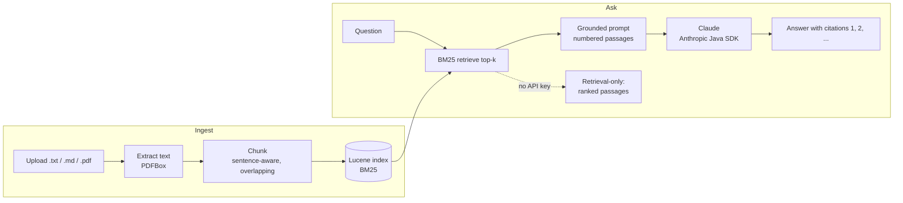

# DocMind

[](https://github.com/Neeraj95464/docmind/actions/workflows/ci.yml)


**Ask questions about your own documents and get answers that cite their sources.**

DocMind is a retrieval-augmented generation (RAG) service written in Java. Upload policies, guides
or notes (`.txt`, `.md`, `.pdf`). DocMind splits them into chunks, indexes them with Apache Lucene,
and answers questions with Claude using only the passages it retrieved. Every claim in an answer
links back to the passage it came from. With no API key set, it still works: it returns the
best-matching passages instead of a generated answer.

## How it works



## Features

- **Ingestion**: `.txt`, `.md` and `.pdf` uploads (Apache PDFBox), 5 MB limit, type checks and file-name sanitising.
- **Chunking**: sentence-aware, overlapping chunks with configurable size and overlap, so facts that span a boundary can still be found.
- **Retrieval**: in-process Apache Lucene index with BM25 ranking and English stemming. The index is stored in a local data directory and rebuilt from the stored originals at startup if it is missing.
- **Grounded generation**: Claude answers only from the retrieved passages, cites them as `[1]`, `[2]`, and says "I don't know" when the passages don't support an answer.
- **Citations**: each citation includes the source file, chunk position, passage text, BM25 score and whether the answer actually cited it.
- **Retrieval-only mode**: without `ANTHROPIC_API_KEY`, DocMind returns the top passages and a clear message instead of failing.
- **API quality**: RFC 9457 `ProblemDetail` errors, Bean Validation, OpenAPI/Swagger UI, Actuator health probes.
- **Web UI**: one static page to upload documents, ask questions and click citations to see the source passage.
- **Ops**: multi-stage, non-root Docker image with a data volume, Docker Compose, GitHub Actions CI and Dependabot.

## Tech stack

| Area | Choice |
|---|---|
| Language / runtime | Java 21 (virtual threads enabled) |
| Framework | Spring Boot 3.5 (Web MVC, Validation, Actuator) |
| Retrieval | Apache Lucene 10 (BM25Similarity, EnglishAnalyzer) |
| Document parsing | Apache PDFBox 3 |
| LLM | Claude via the official [Anthropic Java SDK](https://github.com/anthropics/anthropic-sdk-java) (`com.anthropic:anthropic-java`) |
| API docs | springdoc-openapi (Swagger UI) |
| Tests | JUnit 5, AssertJ, Mockito, Spring MockMvc |
| Delivery | Docker, Docker Compose, GitHub Actions |

## Quick start

### Run with Maven

Requires JDK 21.

```bash
# Optional: enables generated answers. Without it DocMind runs in retrieval-only mode.
export ANTHROPIC_API_KEY=sk-ant-...        # PowerShell: $env:ANTHROPIC_API_KEY="sk-ant-..."

./mvnw spring-boot:run                     # Windows: mvnw.cmd spring-boot:run
```

Open <http://localhost:8080>. Upload the files in [`samples/`](samples) and ask something like
*"How many days of annual leave can I carry forward?"* or *"When does the VPN disconnect?"*.

- Swagger UI: <http://localhost:8080/swagger-ui.html>
- Health: <http://localhost:8080/actuator/health>

### Run with Docker

```bash
cp .env.example .env        # optionally put your ANTHROPIC_API_KEY in .env
docker compose up --build
```

Documents and the index are kept in the `docmind-data` volume, so they survive restarts.

### Configuration

| Property | Env var | Default | Purpose |
|---|---|---|---|
| `docmind.anthropic.api-key` | `ANTHROPIC_API_KEY` | *(empty)* | Empty means retrieval-only mode |
| `docmind.anthropic.model` | `DOCMIND_MODEL` | `claude-sonnet-5-5` | Claude model ID |
| `docmind.anthropic.max-tokens` | | `2048` | Upper limit on response tokens |
| `docmind.anthropic.effort` | | `low` | Claude effort level (`low` to `max`) |
| `docmind.anthropic.timeout` | | `30s` | HTTP timeout per Claude call |
| `docmind.data-dir` | `DOCMIND_DATA_DIR` | `./data` | Stored originals + Lucene index |
| `docmind.chunking.size` / `overlap` | | `800` / `150` | Chunk size and overlap, in characters |
| `docmind.retrieval.default-top-k` / `max-top-k` | | `4` / `8` | Passages per question, and the hard cap |

## API

| Method | Path | Description |
|---|---|---|
| `POST` | `/api/documents` | Upload a document (multipart field `file`) → `201` + metadata |
| `GET` | `/api/documents` | List indexed documents, newest first |
| `DELETE` | `/api/documents/{id}` | Remove a document and its chunks → `204` / `404` |
| `POST` | `/api/ask` | Ask a question → answer, mode, citations, token usage |
| `GET` | `/api/status` | Whether generation is enabled |

```bash
# Upload
curl -F "file=@samples/leave-policy.md" http://localhost:8080/api/documents

# List
curl http://localhost:8080/api/documents

# Ask
curl -X POST http://localhost:8080/api/ask \
     -H "Content-Type: application/json" \
     -d '{"question": "How many days of annual leave can I carry forward?", "topK": 3}'

# Delete
curl -X DELETE http://localhost:8080/api/documents/<id>
```

Example response (illustrative, shortened):

```json
{
  "answer": "You can carry forward up to 5 unused annual leave days, which must be used by 31 March [1].",
  "mode": "GENERATED",
  "model": "claude-sonnet-5-5",
  "citations": [
    {
      "number": 1,
      "fileName": "leave-policy.md",
      "chunkIndex": 1,
      "snippet": "Up to 5 unused annual leave days may be carried forward ...",
      "score": 4.71,
      "cited": true
    }
  ],
  "usage": { "inputTokens": 912, "outputTokens": 64 }
}
```

`mode` is `GENERATED`, `RETRIEVAL_ONLY` (no API key), or `NO_MATCH` (nothing relevant was
indexed, so Claude is not called). Errors use `application/problem+json`. For example, an
unsupported upload returns `415` and a failed Claude call returns `502`.

## Design decisions

**BM25 rather than embeddings, for now.** Lexical BM25 runs in the same process, needs no
embedding provider, no extra API key and no vector database, and gives deterministic results that
are easy to test. For documents like policies and guides, where questions reuse the document's
own words ("annual leave", "VPN"), it works well, and English stemming covers word variants. Its
weakness is synonyms and paraphrase. A vector store and hybrid search are on the roadmap, and
the retrieval layer is a single class (`ChunkIndex`), so it can be swapped out.

**Grounding and citations.** Retrieved passages are numbered and wrapped in `<documents>` tags.
The system prompt tells the model to answer only from them, to cite every claim as `[n]`, and to
reply "I don't know" when they don't contain the answer. The service then reads the `[n]` markers
from the answer, ignores any number that doesn't match a passage, and marks which passages were
actually cited. Each citation therefore points to exactly the passage the model saw.

**The LLM sits behind an interface.** `AnswerGenerator` has one implementation for Claude
(`ClaudeAnswerGenerator`, which uses the official Anthropic Java SDK). Tests use a deterministic
fake, so the whole suite runs offline. Without an API key, no generator bean is created, and the
service falls back to retrieval-only mode instead of failing at startup.

**Cost and latency controls.**
- Only the top-k passages are sent (default 4, server-side cap 8), and chunks are about 200 tokens each, so prompts stay small.
- `max_tokens` is set to 2048 and Claude runs at `low` effort. Grounded Q&A over short passages rarely needs deep reasoning.
- When nothing matches, the model is not called at all.
- Claude calls have a 30 s timeout and 2 SDK retries for 429/5xx errors. Errors are mapped to clear `502` problem details.
- Token usage is returned with every answer, so cost is visible.

**Prompt-injection note.** Uploaded documents are untrusted input. DocMind reduces the risk in
three ways: document text goes inside delimiters, text that tries to close those delimiters is
neutralised, and the system prompt tells the model to treat document content as data and ignore
any instructions in it. User questions are escaped before they reach Lucene, so they can't
inject query syntax. None of this makes prompt injection impossible. Don't index documents from
sources you don't trust, and don't connect the output to actions without a human review step.

## Testing

```bash
./mvnw verify
```

The tests run offline and need no API key:

- **`ChunkerTest`**: size limits, sentence boundaries, overlap, hard-splitting of overlong sentences.
- **`TextExtractorTest`**: txt/md/pdf extraction (generates a PDF on the fly), unsupported and corrupt files.
- **`ChunkIndexTest`**: BM25 ranking on the sample documents, stemming, query escaping, delete, persistence across restarts.
- **`AskServiceTest`**: a fake `AnswerGenerator` checks that citations map to passages, the retrieval-only fallback, the no-match short-circuit and the top-k cap.
- **`PromptBuilderTest`**: passage numbering and delimiter neutralisation.
- **`DocumentServiceTest`**: storage, file-name sanitising, rebuilding the index from stored originals.
- **`ApiControllerTest`** (`@WebMvcTest`): status codes, validation and `ProblemDetail` bodies.
- **`DocMindApplicationTest`**: full context, upload then ask in retrieval-only mode, health and OpenAPI endpoints.

## Roadmap (planned)

- [ ] **Vector store**: embeddings with pgvector for semantic retrieval.
- [ ] **Hybrid search**: combine BM25 and vector scores (reciprocal rank fusion).
- [ ] **Streaming responses**: stream Claude's answer to the UI over Server-Sent Events.
- [ ] **Evaluation set**: a small question/answer set with retrieval recall and answer-faithfulness metrics, run in CI.
- [ ] Optional authentication and per-user document collections.

## Author

**Neeraj Kumar**, Java / Spring Boot developer building AI-powered applications.
[LinkedIn](https://www.linkedin.com/in/neeraj-kumar-10bbb8284/)

## License

[MIT](LICENSE)
